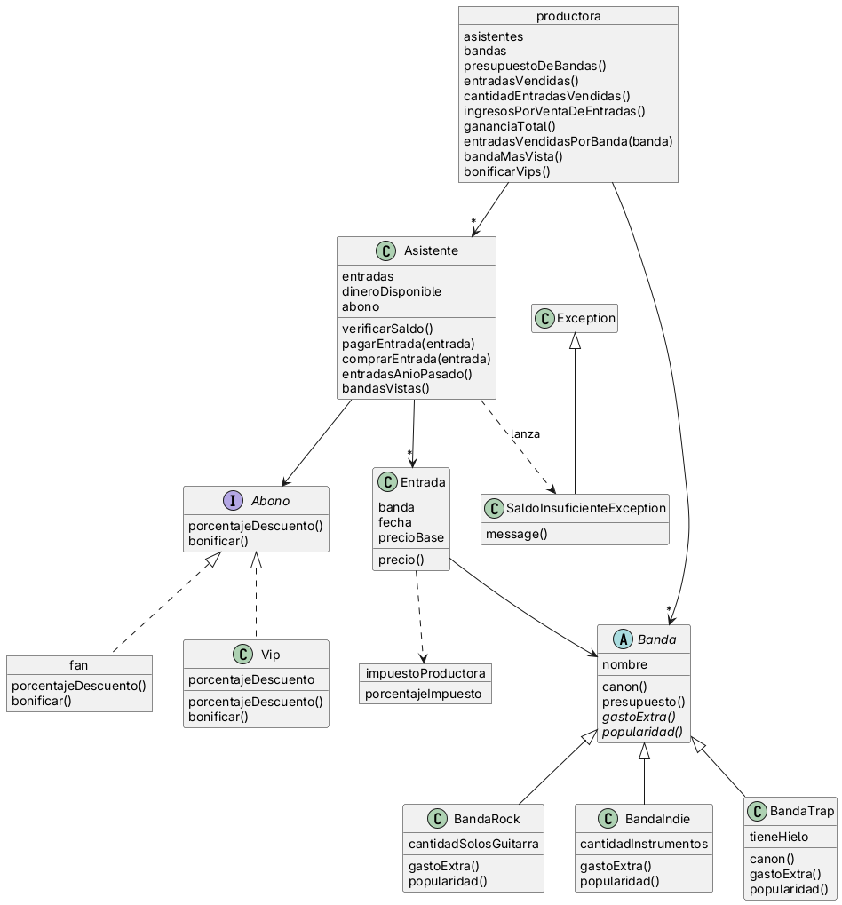

# PDEP-Entertainment

## Diagrama de clases

## Decisiones importantes de diseño

- Abono: (por que se uso composición)
- Banda: (por que se uso herencia)
- ImpuestoProductora: (por que se modeló como un WKO)
- SaldoInsuficienteException: ()
- Productora: (por que se usó como WKO)

## Conceptos de la materia utilizados

- WKO (Well Known Object): 
- Polimorfismo: 
- Herencia: 
- Encapsulamiento: 
- Abstraccion: 
