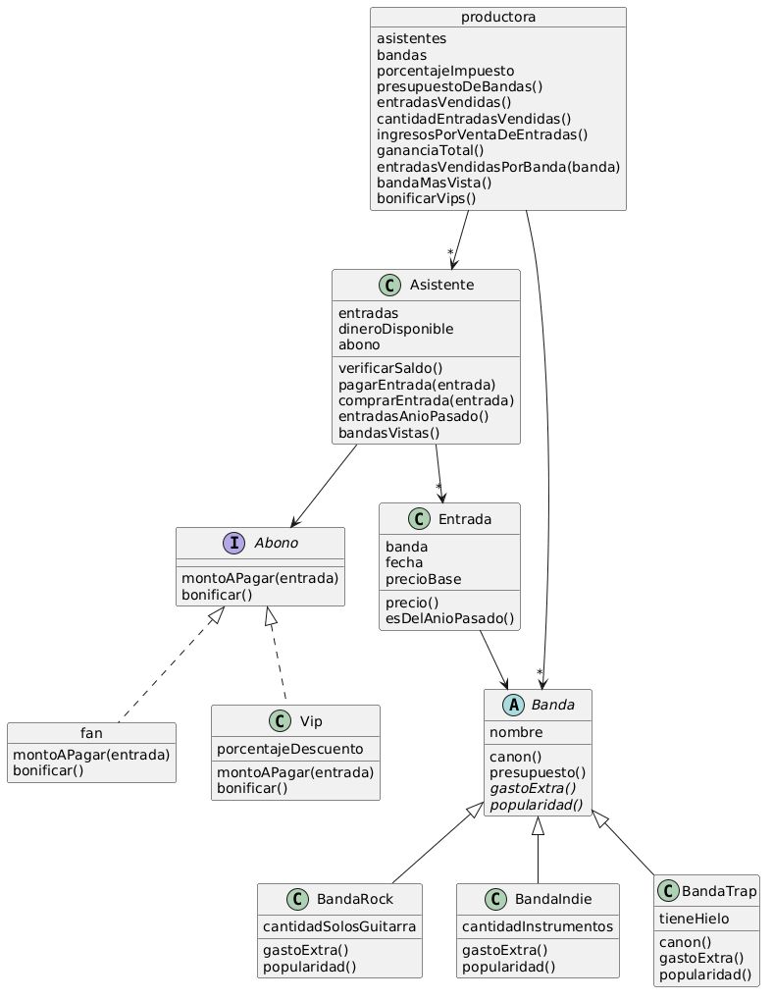

# PDEP-Entertainment

## Decisiones importantes de diseño

- Abono: se usó composición porque el tipo de abono de un asistente puede cambiar en tiempo de ejecución (`abono` es una `var property`). Con herencia (ej. `AsistenteVip`) habría que crear un asistente nuevo para cambiarle el abono.
- Banda: se usó herencia porque todas las bandas comparten estado (`nombre`) y comportamiento (`canon()`, `presupuesto()`), y cada tipo solo redefine lo que le es propio (`gastoExtra()`, `popularidad()` y, en el trap, `canon()`). Además, una banda nunca cambia de tipo.
- SaldoInsuficienteException: es una excepción propia que hereda de `Exception`. El asistente la lanza en `comprarEntrada` cuando no tiene saldo, antes de modificar su estado, así la compra se cancela sin descontar dinero ni agregar la entrada.
- Productora: se usó como WKO porque en el dominio hay una sola productora, y es el punto de acceso a todos los asistentes y bandas.

## Conceptos de la materia utilizados

- WKO (Well Known Object): `productora` y `fan`, que son únicos y no necesitan estado propio por instancia.
- Polimorfismo: `fan` y `Vip` entienden los mismos mensajes (`montoAPagar(entrada)`, `bonificar()`), así que el asistente les pide cuánto pagar por una entrada sin saber cuál tiene. Lo mismo pasa con las bandas, a las que la productora les pide `presupuesto()` sin importar su tipo.
- Herencia: `BandaRock`, `BandaIndie` y `BandaTrap` heredan de `Banda` (con uso de `super()` en `BandaTrap`), y `SaldoInsuficienteException` hereda de `Exception`.
- Composición: el `Asistente` tiene un `abono` (`fan` o `Vip`) y le delega el cálculo del monto a pagar por cada entrada y la bonificación. Como el abono se puede reemplazar, el asistente cambia su comportamiento sin cambiar de clase.
- Abstraccion: `Banda` es una clase abstracta con `gastoExtra()` y `popularidad()` abstractos, y `Abono` es una interfaz que define qué debe saber hacer cualquier abono.

## Diagrama de clases

